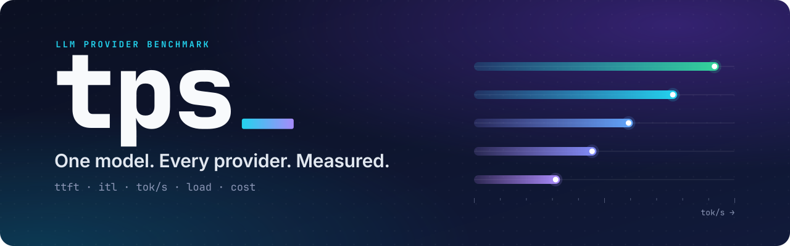

<p align="center">
  
</p>

<p align="center">
  <b>Benchmark one LLM across every provider that serves it.</b><br>
  Time-to-first-token · inter-token latency · tok/s · throughput under load · failures · cost.
</p>

<p align="center">
  <a href="https://github.com/teal-sea/tpsbench/actions/workflows/selftest.yml"></a>
  
  
  <a href="LICENSE"></a>
</p>

<p align="center">
  <a href="#quick-start">Quick start</a> ·
  <a href="docs/getting-started.md">Guide</a> ·
  <a href="docs/cli.md">CLI reference</a> ·
  <a href="docs/methodology.md">Methodology</a> ·
  <a href="AGENTS.md">For agents</a>
</p>

<p align="center">
  
  <br><sub>Demo data from <code>tps run -c targets.mock.toml --mock</code> — offline, instant, no key.</sub>
</p>

## Why

The same open-weights model is served by a dozen providers at a 30× price spread.
Their dashboards report their own numbers, over their own window, from their own
side of the network. **`tps` holds the model constant, swaps the upstream, and
measures from where you sit** — streaming, interleaved, pinned to one upstream per
row.

## Quick start

```bash
git clone https://github.com/teal-sea/tpsbench && cd tpsbench
pipx install .                          # gives you `tps`  (or: uv tool install . · python -m tps)

tps run -c targets.mock.toml --mock     # see the whole pipeline offline, no key needed
```

Then measure for real — 11 curated DeepSeek-V4.1-Flash providers, 385 requests,
about 20 minutes and a few cents:

```bash
export OPENROUTER_API_KEY=sk-or-...
tps doctor -c targets.v4.1-flash.toml        # environment, config, credentials
tps run -c targets.v4.1-flash.toml           # the measurement
```

Your own endpoint, no OpenRouter and no config file:

```bash
tps run --base-url https://api.example.com/v1 --model <id> --api-key-env EXAMPLE_API_KEY --dry-run
```

Every provider of your model: `tps init --model <author>/<slug>` writes one
pinned target per OpenRouter endpoint into `targets.toml`. That can be 40+
targets — `tps run --dry-run` prints the requests, worst-case cost and rough time
before anything is sent.

Python 3.11+. One dependency (`httpx`); `pipx install ".[http2]"` adds HTTP/2.
Any OpenAI-compatible endpoint works — OpenRouter is just the easiest way to
reach every upstream with one key.

## What it answers

| Question | Command |
|---|---|
| Who serves this model, at what price and quantization? | `tps discover <model>` |
| Which provider is fastest? Snappiest? Cheapest per real request? | `tps run` |
| Does it scale, or just queue, when I send 16 at once? | `tps run --concurrency 1,16` |
| What does the gateway hop cost me? | `tps run` with `baseline =` |
| Did that provider get worse since last week? | `tps run` twice, diff `summary.csv` |

## How it stays honest

- **Interleaved, not batched.** Target order rotates every rep, so a 30-second
  provider blip is spread across rows instead of landing on whoever ran first.
- **Pinned upstreams.** `discover` writes full tag slugs with
  `allow_fallbacks = false`; the report shows who actually served each request.
- **No retries.** A 429 at concurrency 16 is a result, so it's counted, not
  smoothed away.
- **Real token counts.** Taken from `usage`. When a provider omits it, the
  chars/4 estimate is flagged with `≈` everywhere it appears.
- **Tails mean tails.** `p90` is always the slow side, for tok/s too.
- **Decode rate that can't be gamed.** Prefill is excluded, first-chunk tokens
  aren't credited to the window, and a single-chunk reply gets *no* rate instead
  of an infinite one.
- **Mock data can't leak.** Synthetic runs are flagged in every output, and mock
  profiles are ignored unless you pass `--mock`.
- **Ctrl-C loses nothing.** Results stream to disk; an interrupted run still gets
  a report, flagged `PARTIAL`.

The full checklist for a comparison that survives review is in
[methodology](docs/methodology.md); every number is defined in
[metrics](docs/metrics.md).

## Built for scripts and agents

Every command takes `--json` and prints exactly one object on stdout, with stable
exit codes (`0` ok · `1` usage · `2` credentials · `3` provider · `4` all failed ·
`130` interrupted):

```bash
tps run --json | jq '.results | sort_by(-.out_tps_p50) | .[:3] | .[] | {target, out_tps_p50, ttft_p50_s, ok, n}'
```

[AGENTS.md](AGENTS.md) is the dense contract for coding agents;
[automation](docs/automation.md) covers CI gates and cron.

## Documentation

| Doc | What's in it |
|---|---|
| [Getting started](docs/getting-started.md) | install → first measurement → reading the output |
| [CLI reference](docs/cli.md) | every command and flag, exit codes, JSON schema |
| [Configuration](docs/configuration.md) | `targets.toml` anatomy, pinning, prices, prompts |
| [Metrics](docs/metrics.md) | exact definition of every number |
| [Methodology](docs/methodology.md) | what makes a comparison fair, and what silently invalidates one |
| [Gateways](docs/gateways.md) | hop overhead vs routing choice vs gateway-vs-gateway |
| [Automation](docs/automation.md) | CI, cron, `--json` contracts, agent usage |
| [Troubleshooting](docs/troubleshooting.md) | the errors you will actually hit |
| [FAQ](docs/faq.md) | short answers |

Browse them as a site with `pip install -e ".[docs]" && mkdocs serve`. The
GitHub wiki is generated from the same files (`scripts/publish-wiki.sh`).

## Why not an existing benchmark

| Tool | Gives you | Gap |
|---|---|---|
| [Artificial Analysis](https://artificialanalysis.ai/api-reference) | Independent medians per model | One row per **model**, not per **upstream** |
| [OpenRouter routing](https://openrouter.ai/docs/guides/routing/provider-selection.md) | Provider-reported p50/p90, pinning | Self-reported, rolling window, only their endpoints |
| [LLMPerf](https://github.com/ray-project/llmperf) | Real load generation | Validates *an* endpoint; N vendors = N harnesses |
| [GenAI-Perf](https://developer.nvidia.com/blog/llm-performance-benchmarking-measuring-nvidia-nim-performance-with-genai-perf/) | Serving benchmark | Aimed at NIM/Triton, heavyweight for comparing APIs |

None of them hold the model constant, swap the upstream, and **interleave** the
measurements so a blip doesn't get attributed to whoever ran first.

## Project layout

```
tps/                 package: core.py (engine), cli.py (commands), ui.py (terminal)
tests/selftest.py    offline checks against a local SSE server — no network, no keys
docs/                the documentation above (also the mkdocs site and the wiki)
examples/            demo throughput report
targets.*.toml       ready-made configs: mock demo, curated, full, gateway, example
scripts/             wiki publisher, README asset renderer
```

## Development

```bash
pip install -e ".[http2,dev]"
python tests/selftest.py               # the whole suite, offline
ruff check . && ruff format --check .
python scripts/render_assets.py        # re-render README images from real CLI output (".[assets]")
```

[Contributing](CONTRIBUTING.md) · [Security policy](SECURITY.md) · [Changelog](CHANGELOG.md)

## Limits

- Chat-completions SSE only — no Responses API, embeddings, images, audio.
- Numbers are from *your* network position: latency includes your RTT.
- Speed and quality are separate questions; `tps` answers speed, not quality.

## License

MIT
