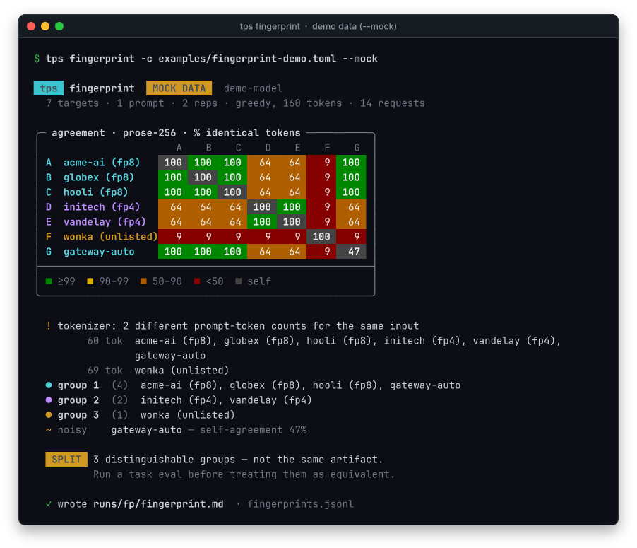

# Fingerprinting: same weights, or just the same name?

A model slug is not an artifact. Behind `deepseek/deepseek-v4.1-flash` you can
find fp4, fp8, mxfp4, and a dozen endpoints that decline to say — plus, in
principle, distilled siblings and stale revisions. Speed and price cannot tell
them apart. This does.

```bash
tps fingerprint -c targets.toml
```

## How it works

1. Every target is sent the same prompt **twice**, at `temperature = 0`,
   non-streaming, with `logprobs` and `top_logprobs`.
2. Each target's two runs are compared with each other — that's its **noise
   floor**. Batching and kernel nondeterminism mean no endpoint is bit-exact
   across calls.
3. Targets are compared with each other on the token sequence of run 1. A
   completion that stops early counts the missing tokens as disagreement.
4. Cache aside, greedy decoding is nearly a function of the weights. Identical
   weights and kernels reproduce the same tokens; fp4 vs fp8 diverges within a few
   dozen tokens; a distilled model diverges almost immediately.
5. Cheap independent check: `usage.prompt_tokens` for the same input string. Same
   tokenizer and chat template ⇒ same count.

## Reading the output

| Observation | Reading |
|---|---|
| `self_agreement` < 98% | that endpoint is not deterministic run-to-run; its cross-provider agreement means nothing |
| pair ≥ 99% | same weights, same kernels — or indistinguishable at this length |
| pair 90–99%, divergence deep | same base model, different quantization or kernels |
| pair < 90%, divergence early | **different artifact** — distilled, older revision, another model |
| `prompt_tokens` differ for identical input | different tokenizer or chat template; not the same serving stack |

Clusters are the summary: targets are unioned when their agreement clears both
their noise floors (`max(0.98, min_floor − 0.01)`). The **verdict** reads them:

| Verdict | Meaning |
|---|---|
| `split` | two or more distinguishable groups among deterministic targets |
| `consistent` | one group — indistinguishable at this resolution |
| `inconclusive` | fewer than two deterministic targets returned data |

Two things never move the verdict: a target whose request **failed** (listed
under *no data* — absence of evidence, not different weights), and a target that
is **non-deterministic** at temperature 0 (its placement can't be interpreted).
With `--reps 1` there is no noise floor, and the report says so.



## What it costs

11 targets × 2 prompts × 2 reps × 160 tokens ≈ 7k tokens. A few cents and about a
minute. Run it before you write a pricing decision into anything.

Try the output offline, with fictional providers:

```bash
tps fingerprint -c examples/fingerprint-demo.toml --mock
```

## Limits — read these

- **It can fail to disprove identity. It cannot prove it.** A distilled model can
  survive 150 tokens of prose; a longer probe or a domain-specific prompt catches
  more, not all.
- **Providers without `logprobs`** degrade to whole-text equality, which only
  catches gross differences (mode `text` in `fingerprints.jsonl`).
- **Two providers on the same hardware with the same weights can still diverge**
  from batch-size-dependent numerics. That is why the noise floor exists — a pair
  near the floor is evidence, not proof.
- **Reasoning models** may emit hidden tokens that change the visible sequence;
  compare like with like.
- **Quantization is not fraud.** fp4 at half the price may be exactly what you
  want. The point is to know which is which, then run a task eval.

## The cheap smell test

Before fingerprinting anything, look at the `discover` table:

- A price far below the median for the same model is usually fewer bits or a
  smaller model, not a miracle.
- A provider with no quantization listed is not necessarily fp8 — it is unknown.
- A speed gap of 3× between two "identical" endpoints is a weights/quantization
  signal, not a serving-optimization signal.

Fingerprint to confirm, then evaluate quality on your own task. Speed, weights and
quality are three different questions and the tool only answers the first two.
