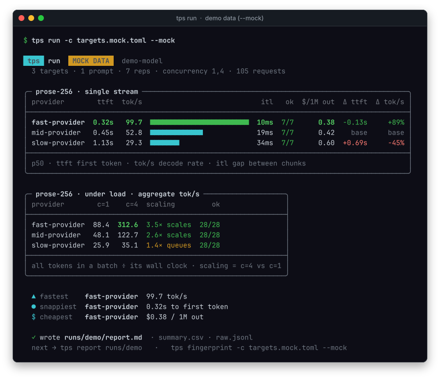

# Getting started

Ten minutes from zero to a real comparison.

## 1. Install

```bash
git clone https://github.com/teal-sea/tpsbench
cd tpsbench
pipx install .
```

`pipx` keeps it isolated and puts `tps` on your PATH. Alternatives:

```bash
uv tool install .        # same result, uv-native
python -m tps --help     # no install; run from the repo checkout
```

Check it:

```bash
tps --version
tps doctor
```

`doctor` inspects Python, `httpx`, HTTP/2, your config, and credentials. ✗ rows
are blocking; `!` rows are optional. Add `--network` to also probe each
`base_url`.

No key yet? See the whole pipeline offline first:

```bash
tps run -c targets.mock.toml --mock      # synthetic numbers, flagged MOCK DATA
```

## 2. Point it at an endpoint

**Your own endpoint, no config file** — any OpenAI-compatible API (a vendor's
own platform, a token plan, vLLM on a box under your desk):

```bash
export EXAMPLE_API_KEY=sk-...
tps run --base-url https://api.example.com/v1 --model some-model-id \
        --api-key-env EXAMPLE_API_KEY --price 0.30,1.20 --dry-run
```

`--dry-run` prints the requests, tokens, worst-case cost and rough time, and
sends nothing; drop it to measure. `--price` (USD per 1M input,output tokens) is
optional and only fills the cost columns. The run saves the generated config as
`runs/<timestamp>/targets.toml`; `tps init --endpoint … --model …` writes the same
file up front, ready for more `[[targets]]` blocks.

**Claude**, on an API key or a Claude subscription token — the native API, so
no `temperature` is sent and hidden thinking stays out of tok/s:

```bash
tps run --api anthropic --model claude-opus-5-5 --api-key-env ANTHROPIC_API_KEY \
        --price 4,20 --max-tokens 2048
```

`--max-tokens 2048` matters: at the built-in prompts' 256-token cap Claude
usually spends the whole budget thinking and never answers (the row says so).

**Every provider of a model, via OpenRouter:**

```bash
tps discover deepseek/deepseek-v4.1-flash --out targets.toml
```

This asks OpenRouter which upstreams serve that model and prints their price,
quantization and context. With `--out` it writes a config containing **one pinned
target per endpoint**:

```toml
[[targets]]
name = "DeepInfra (fp8)"
base_url = "https://openrouter.ai/api/v1"
model = "deepseek/deepseek-v4.1-flash"
api_key_env = "OPENROUTER_API_KEY"
extra_body.provider = { only = ["deepinfra/fp8"], allow_fallbacks = false, quantizations = ["fp8"] }
price = { in_per_1m = 0.14, out_per_1m = 0.42 }
```

Already know your endpoints? `tps init` writes a commented starter you can edit.

## 3. Set a key

```bash
export OPENROUTER_API_KEY=sk-or-...
tps doctor          # credentials row should go green
```

Any OpenAI-compatible endpoint works — the key just has to match `api_key_env` in
the target. OpenRouter is convenient because one key reaches every upstream.

## 4. Measure

```bash
tps run -c targets.toml --dry-run    # what it will cost first; nothing sent
tps run -c targets.toml
```

A progress bar with an ETA runs while it measures; then you get a table per
prompt, an under-load table if you configured more than one concurrency, and the
rankings (shown here on the offline demo):



Best values are highlighted; `≈` marks a rate whose token count had to be
estimated; `Δ` columns appear when the config names a `baseline`.

Artifacts land in `runs/<timestamp>/`:

| File | Contents |
|---|---|
| `report.md` | full tables, aggregate throughput, cost, failures |
| `summary.csv` | one row per prompt × provider × concurrency, each with its own stats |
| `raw.jsonl` | every request, written as it lands; re-analyse without spending tokens |
| `meta.json` | what was configured (model, pins, prices, mock flag, completion) |

Re-render anytime: `tps report runs/2026-10-27T12-45-39Z`. Interrupted with
Ctrl-C? The finished requests are kept and the report is flagged `PARTIAL`.

## Reading the numbers

- **Compare `tok/s` at equal `ttft`.** A provider that returns one token instantly
  and then crawls is not fast.
- **Check `ok`.** 6/7 means one failure; at concurrency 16, `ok` falling off is
  rate limiting, not slowness — the under-load table shows it per level.
- **Check `out tok`.** A provider that stops early looks fast. The report prints
  the median; compare it before comparing speed.
- **Reasoning models need room.** If a row warns *measured thinking, not
  answering*, the model spent its whole `max_tokens` reasoning: TTFT and tok/s are
  real but time the thinking, and there is no ITL. Re-run with `--max-tokens 2048`.
- **Check your own noise first.** Two consecutive runs of the same config tell you
  more than any single p90.

## Next

- [Configuration](configuration.md) — concurrency sweeps, prompts, baselines
- [Methodology](methodology.md) — the nine ways a provider comparison lies
- [Automation](automation.md) — running this on a schedule or in CI
